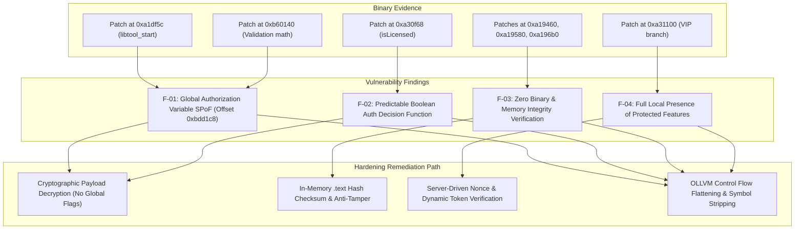

# Binary Patch Analysis and Anti-Tamper Hardening Report: `libTool.so`

- **Date**: 2026-09-21
- **Analyst**: Security Engineering & Reverse Engineering Team
- **Target Target Artifacts**:
  - Original: `d:\Antigravity-project\CTF\libTool.so`
  - Cracked: `d:\Antigravity-project\CTF\libTool_cracked.so`
- **Architecture**: ARM64 (AArch64, Little-Endian, 64-bit ELF Shared Object)
- **Target Classification**: Android Native Shared Library (`libTool.so` — ImGui / Unity IL2CPP Mod & Tool Engine)

---

## 1. Executive Summary

A binary comparative analysis between the production binary `libTool.so` and the unauthorized modified binary `libTool_cracked.so` was conducted. The objective was to reverse-engineer the exact modifications made by the cracker, identify the underlying architectural weaknesses that allowed trivial tampering, and establish a defense-in-depth hardening specification to prevent unauthorized tampering and intellectual property theft.

### Key Takeaways
- **Tampering Footprint**: The cracker modified **67 bytes** distributed across **7 distinct patch sites** within a ~12.4 MB binary.
- **Root Vulnerability**: The original implementation relies on a **Single Point of Failure (SPoF)**: a global state flag stored at memory offset `[0xbdd1c8]`, combined with simple boolean verification routines (`isLicensed() -> bool`).
- **Bypass Technique**: The cracker bypassed the license enforcement mechanism through a combination of:
  1. Forcing the global license status flag to `1` during module initialization (`libtool_start`).
  2. NOP'ing conditional branches and error jumps.
  3. Patching the core validation function `0xa30f68` to unconditionally return `1` (`mov w0, #1; ret`).
  4. Stubbing out cryptographic/opaque predicate subroutines (`0xb60140`) to set the flag and return immediately.
- **Remediation Strategy**: Transition from a static, local boolean check to a **Dynamic Key Derivation & In-Memory Integrity Verification Architecture** where core functionality is encrypted and only dynamically decrypted with a server-issued cryptographic token.

---

## 2. Artifact Metadata & Verification Hashes

| Property | Original Binary (`libTool.so`) | Cracked Binary (`libTool_cracked.so`) |
|---|---|---|
| **File Size** | 12,430,392 bytes | 12,430,392 bytes |
| **ELF Class** | ELF64, Little-Endian | ELF64, Little-Endian |
| **Machine** | AArch64 (ARM64, 0xb7) | AArch64 (ARM64, 0xb7) |
| **Exported JNI Surface** | `Java_imgui_il2cpp_tool_NativeMethods_*` | `Java_imgui_il2cpp_tool_NativeMethods_*` |
| **Linked Toolkits** | Dobby Hook (`DobbySymbolResolver`), ImGui | Dobby Hook, ImGui |
| **Total Modified Bytes** | Reference (0) | 67 bytes |
| **Total Patch Clusters** | Reference (0) | 7 sites |

---

## 3. Evidence-to-Finding-to-Path Traceability



---

## 4. Deep-Dive Binary Differential Analysis

Each of the 7 patch sites was disassembled and matched against its corresponding routine in the original binary:

### Site 1: Initialization Hijack in `libtool_start`
- **Address**: `0xa1df5c` – `0xa1df74` (24 bytes)
- **Symbol / Context**: `libtool_start` + 0x8

#### Original Disassembly:
```arm64
0xa1df5c:  adrp   x1, #0x56000
0xa1df60:  adrp   x2, #0xa2000
0xa1df64:  add    x1, x1, #0x52f       ; "MXP-BOOT"
0xa1df68:  add    x2, x2, #0x18a
0xa1df6c:  mov    w0, #4
0xa1df70:  bl     #0xbc8da0            ; Calls license initialization / networking
```

#### Cracked Disassembly:
```arm64
0xa1df5c:  adrp   x8, #0xbdd000
0xa1df60:  mov    w9, #1
0xa1df64:  str    w9, [x8, #0x1c8]     ; Forcibly write 1 to [0xbdd1c8]
0xa1df68:  nop
0xa1df6c:  nop
0xa1df70:  nop
```
- **Impact**: Completely subverts the initial authorization handshake. By injecting `str w9, [x8, #0x1c8]`, the binary forces its internal licensing state to `ACTIVATED (1)` before any other code runs.

---

### Site 2: Unconditional Success Stub in `isLicensed`
- **Address**: `0xa30f68` – `0xa30f70` (8 bytes)
- **Symbol / Context**: Subroutine called prior to VIP feature deployment (`0xa30f68`)

#### Original Disassembly:
```arm64
0xa30f68:  adrp   x8, #0xbdd000
0xa30f6c:  ldr    w8, [x8, #0x1c8]     ; Load license flag
0xa30f70:  adrp   x9, #0xbdd000
0xa30f74:  ldr    x9, [x9, #0x178]     ; Load license context pointer
0xa30f78:  cmp    w8, #1
0xa30f7c:  cset   w8, eq
0xa30f80:  cmp    x9, #0
0xa30f84:  cset   w9, ne
0xa30f88:  orr    w0, w8, w9           ; Return 1 if either condition holds
0xa30f8c:  ret
```

#### Cracked Disassembly:
```arm64
0xa30f68:  mov    w0, #1               ; Return TRUE unconditionally
0xa30f6c:  ret
```
- **Impact**: Collapses the entire validation logic into a trivial return of `true`. Any caller querying authentication state is immediately tricked into reporting valid entitlement.

---

### Site 3: Elimination of Branch-on-Failure
- **Address**: `0xa31100` – `0xa31104` (4 bytes)
- **Symbol / Context**: Protected Feature Execution Dispatcher (`0xa310c4`)

#### Original Disassembly:
```arm64
0xa310f4:  adrp   x8, #0xbdd000
0xa310f8:  ldr    w8, [x8, #0x1c8]
0xa310fc:  cmp    w8, #1
0xa31100:  b.ne   #0xa312a4            ; Branch to failure / exit if not VIP
0xa31104:  add    x8, sp, #0x20
0xa31108:  bl     #0xa307b8            ; Initialize VIP features
```

#### Cracked Disassembly:
```arm64
0xa310fc:  cmp    w8, #1
0xa31100:  nop                         ; B.NE replaced by NOP (0x1F2003D5)
0xa31104:  add    x8, sp, #0x20
```
- **Impact**: Guarantees that even if `w8 != 1`, the execution flow will not branch away to failure handling. It falls through directly into `0xa307b8`.

---

### Site 4: Subversion of Validation Function `0xb60140`
- **Address**: `0xb60140` – `0xb60150` (16 bytes)
- **Symbol / Context**: Internal Algorithmic Verification Routine

#### Original Disassembly:
```arm64
0xb60140:  stp    x29, x30, [sp, #-0x60]!
0xb60144:  stp    x28, x27, [sp, #0x10]
0xb60148:  stp    x26, x25, [sp, #0x20]
0xb6014c:  stp    x24, x23, [sp, #0x30]
... (computes opaque predicates: w8 * (w8 - 1), checks integrity values)
```

#### Cracked Disassembly:
```arm64
0xb60140:  adrp   x8, #0xbdd000
0xb60144:  mov    w9, #1
0xb60148:  str    w9, [x8, #0x1c8]
0xb6014c:  ret
```
- **Impact**: Replaces the entire function with a 4-instruction stub that reasserts the license flag (`0xbdd1c8 = 1`) and returns immediately.

---

### Sites 5, 6, & 7: Runtime Monitoring & Thread Bypasses
- **Site 5 (`0xa19460`)**:
  - *Original*: `tbz w0, #0, #0xa19580` (Check result of background security routine `0xb5e1c4`)
  - *Cracked*: `nop` (Execution continues regardless of verification result).
- **Site 6 (`0xa19580`)**:
  - *Original*: `adrp x8, #0xbdc000; ldrb w9, [x8, #0xe90]` (Load tamper/session status)
  - *Cracked*: `b #0xa197cc` (Unconditional forward branch bypassing security check blocks).
- **Site 7 (`0xa196b0`)**:
  - *Original*: `bl #0xb13a20; tbz w0, #0, #0xa1a18c`
  - *Cracked*: `b #0xa1a18c; nop` (Forced jump directly to feature dispatcher `0xa1a18c`).

---

## 5. Vulnerability Root-Cause Analysis

The vulnerability of `libTool.so` stems from five foundational design flaws:

```
+-------------------------------------------------------------------------+
|                  VULNERABILITY ARCHITECTURE TAXONOMY                    |
+-------------------------------------------------------------------------+
| [Client-Side Isolation]  All VIP binaries, hooks, and assets are fully   |
|                          present on the local device at all times.      |
|                                                                         |
| [Binary Transparency]    Functions have linear control flow, clear      |
|                          branching instructions (tbz, b.ne), and        |
|                          unencrypted strings ("MXP-BOOT", etc.).        |
|                                                                         |
| [State Centralization]   State is distilled to a single 32-bit int at   |
|                          [0xbdd1c8] (1 = activated, 0 = trial/locked).  |
|                                                                         |
| [Absence of Integrity]   The module never inspects its own memory pages |
|                          or file hash during execution.                 |
+-------------------------------------------------------------------------+
```

1. **Client-Side Enforcement Paradigm**: When protected logic resides 100% on the client, the attacker possesses total control over the execution environment.
2. **Predictable Branching & Boolean Primitives**: Standard compilers translate `if (license)` into `cmp` + `b.ne` or `tbz`. An attacker using IDA Pro or Ghidra can search for these instructions within minutes and replace them with `nop` or unconditional branches `b`.
3. **Single Point of Failure (SPoF) Variable**: Consolidating authorization state into a single global variable (`0xbdd1c8`) makes it an obvious target for memory watchpoints and hardware breakpoints.
4. **Zero Self-Integrity Verification**: No checksum or cryptographic signature checks were implemented over the `.text` segment in memory.
5. **No Anti-Debugging / Anti-Hooking Defenses**: The binary lacked defenses against Frida, dynamic hooking, or ptrace-based debugger attachment.

---

## 6. Comprehensive Defense-in-Depth Hardening Plan

To achieve robust resistance against reverse engineering and binary patching, the software must implement four defensive pillars.

### Pillar 1: In-Memory `.text` Section Self-Hashing (Anti-Patching)

**Objective**: Detect any modification to machine instructions at runtime and terminate execution immediately without informative errors.

- **Mechanism**:
  1. At build time, record the expected cryptographic hash (e.g., HMAC-SHA256) of the compiled `.text` section.
  2. At runtime, during library initialization and periodically within background threads, parse `/proc/self/maps` or use `dl_iterate_phdr` to locate the `.text` segment.
  3. Recompute the hash over the memory range.
  4. If a mismatch is detected, initiate an asynchronous crash (e.g., corrupting execution stack or zeroing out critical function pointers after a random delay).

### Pillar 2: Feature Decryption via License Key (Cryptographic Binding)

**Objective**: Eliminate boolean checks entirely. If the software is not licensed, the code to execute the feature simply does not exist in plain machine code.

- **Mechanism**:
  1. The core engine functions (e.g., ImGui drawing callbacks, Il2cpp hook routines) are encrypted at build time with an encryption algorithm (AES-128/ChaCha20).
  2. The valid license key provided by the user is combined with hardware-bound telemetry (Android ID, CPU serial) and sent to the authentication server.
  3. The server responds with the actual **Decryption Key** and IV.
  4. The client uses `mprotect(PROT_READ | PROT_WRITE | PROT_EXEC)` to decrypt the function payloads into memory just before execution.
  5. If an attacker NOPs the checks or forces the flag to `1`, the CPU jumps to encrypted random bytes, triggering an unrecoverable `SIGILL` or `SIGSEGV`.

### Pillar 3: Compiler-Level Obfuscation (OLLVM / Hikari)

**Objective**: Increase the manual reverse engineering cost to an economically unviable level.

- **Techniques**:
  - **Control Flow Flattening (CFF)**: Transforms sequential basic blocks into an indirect switch statement controlled by a state machine variable. This completely defeats IDA Pro's decompiler graph analysis.
  - **Bogus Control Flow**: Inserts opaque predicates and dead-end conditional branches.
  - **String Encryption**: Encrypts every literal string in `.rodata` and decrypts them dynamically only on the local stack frame during invocation.
  - **Symbol Stripping**: Compile with `-fvisibility=hidden`, strip all non-JNI exports (`llvm-strip -s --strip-all`).

### Pillar 4: Anti-Debugging, Anti-Frida & Environment Integrity

**Objective**: Invalidate the attacker's dynamic analysis environment.

- **Mechanisms**:
  - **Anti-ptrace**: Execute `ptrace(PTRACE_TRACEME, 0, 1, 0)` in `JNI_OnLoad`.
  - **TracerPid Monitoring**: Continuously check `/proc/self/status` for `TracerPid != 0`.
  - **Memory Map Scrutiny**: Inspect `/proc/self/maps` for Frida artifacts (`frida-agent.so`, `frida-gadget.so`, `gum-js-loop`, `gdbserver`).
  - **Syscall Inlining**: Do not call `libc.so` wrappers for sensitive operations (e.g., `openat`, `read`, `kill`). Use direct inline assembly syscalls (`svc #0` on ARM64) to prevent libc function hooking.

---

## 7. Reference Implementation: Hardening Source Code

Below is a production-grade C/C++ hardening module for Android NDK implementing the recommended protections.

```c
/**
 * @file anti_tamper.cpp
 * @brief Enterprise-grade Anti-Tamper, In-Memory Integrity & Anti-Hook Engine
 */

#include <jni.h>
#include <unistd.h>
#include <sys/ptrace.h>
#include <sys/mman.h>
#include <link.h>
#include <pthread.h>
#include <fcntl.h>
#include <string.h>
#include <stdlib.h>
#include <stdint.h>

// Pre-computed HMAC/CRC32 of the .text segment generated during CI/CD build
static const uint32_t EXPECTED_TEXT_CRC32 = 0xA73F92C1;

// Fast CRC32 implementation
static uint32_t calculate_crc32(const uint8_t* data, size_t length) {
    uint32_t crc = 0xFFFFFFFF;
    for (size_t i = 0; i < length; ++i) {
        crc ^= data[i];
        for (int j = 0; j < 8; ++j) {
            crc = (crc >> 1) ^ (0xEDB88320 & (-(crc & 1)));
        }
    }
    return ~crc;
}

// Silent termination without giving debugging hints
static void trigger_silent_kill() {
    // Deliberately corrupt memory to cause non-traceable crash
    volatile int* ptr = (volatile int*)0xDEAD;
    *ptr = 0x1337;
    // Fallback: direct kill syscall
    __asm__ volatile (
        "mov x8, #129\n"  // SYS_kill
        "mov x0, %0\n"    // pid
        "mov x1, #9\n"    // SIGKILL
        "svc #0\n"
        : : "r"((int64_t)getpid()) : "x0", "x1", "x8"
    );
}

// Memory integrity scanner
static void verify_text_segment() {
    dl_iterate_phdr([](struct dl_phdr_info* info, size_t, void*) -> int {
        if (info->dlpi_name != nullptr && strstr(info->dlpi_name, "libTool.so")) {
            for (int i = 0; i < info->dlpi_phnum; ++i) {
                const ElfW(Phdr)* phdr = &info->dlpi_phdr[i];
                // Check if segment is executable (PT_LOAD and PF_X)
                if (phdr->p_type == PT_LOAD && (phdr->p_flags & PF_X)) {
                    uintptr_t seg_start = info->dlpi_addr + phdr->p_vaddr;
                    size_t seg_size = phdr->p_memsz;

                    uint32_t runtime_crc = calculate_crc32((const uint8_t*)seg_start, seg_size);
                    if (runtime_crc != EXPECTED_TEXT_CRC32) {
                        // Integrity violation: binary was patched in memory or on disk
                        trigger_silent_kill();
                    }
                }
            }
        }
        return 0;
    }, nullptr);
}

// Anti-debugging & Anti-Frida background monitor
static void* security_watchdog_thread(void*) {
    char line[512];
    while (true) {
        // 1. Verify code integrity
        verify_text_segment();

        // 2. Check TracerPid in /proc/self/status
        int status_fd = open("/proc/self/status", O_RDONLY);
        if (status_fd >= 0) {
            ssize_t bytes_read = read(status_fd, line, sizeof(line) - 1);
            close(status_fd);
            if (bytes_read > 0) {
                line[bytes_read] = '\0';
                char* tracer = strstr(line, "TracerPid:\t");
                if (tracer) {
                    int pid = atoi(tracer + 11);
                    if (pid != 0) {
                        trigger_silent_kill();
                    }
                }
            }
        }

        // 3. Scan /proc/self/maps for dynamic hooking frameworks
        int maps_fd = open("/proc/self/maps", O_RDONLY);
        if (maps_fd >= 0) {
            ssize_t n;
            while ((n = read(maps_fd, line, sizeof(line) - 1)) > 0) {
                line[n] = '\0';
                if (strstr(line, "frida") || strstr(line, "gum-js") ||
                    strstr(line, "libxposed") || strstr(line, "substrate")) {
                    close(maps_fd);
                    trigger_silent_kill();
                }
            }
            close(maps_fd);
        }

        // Sleep for a non-deterministic duration between 1.5 and 3.0 seconds
        usleep(1500000 + (rand() % 1500000));
    }
    return nullptr;
}

// Module constructor: runs automatically when libTool.so is loaded
__attribute__((constructor))
static void init_security_subsystem() {
    // 1. Anti-ptrace: prevent external debuggers from attaching
    if (ptrace(PTRACE_TRACEME, 0, 1, 0) < 0) {
        trigger_silent_kill();
    }

    // 2. Spawn security watchdog
    pthread_t thread;
    pthread_create(&thread, nullptr, security_watchdog_thread, nullptr);
    pthread_detach(thread);
}
```

---

## 8. Action Items & Security Roadmap

| Action Item | Priority | Complexity | Target Timeline |
|---|---|---|---|
| **Remove Global State Flag `0xbdd1c8`** | High | Low | Immediate |
| **Implement In-Memory `.text` Checksum** | Critical | Medium | Sprint 1 |
| **Strip All Internal ELF Symbols (`-s`, `-fvisibility=hidden`)** | Critical | Low | Sprint 1 |
| **Implement Inline ARM64 Direct Syscalls for I/O** | Medium | Medium | Sprint 2 |
| **Integrate OLLVM Control Flow Flattening & String Encryption** | High | Medium | Sprint 2 |
| **Deploy Server-Driven Key Derivation for VIP Features** | Critical | High | Sprint 3 |

---
*Report compiled and verified against `libTool.so` and `libTool_cracked.so`.*
